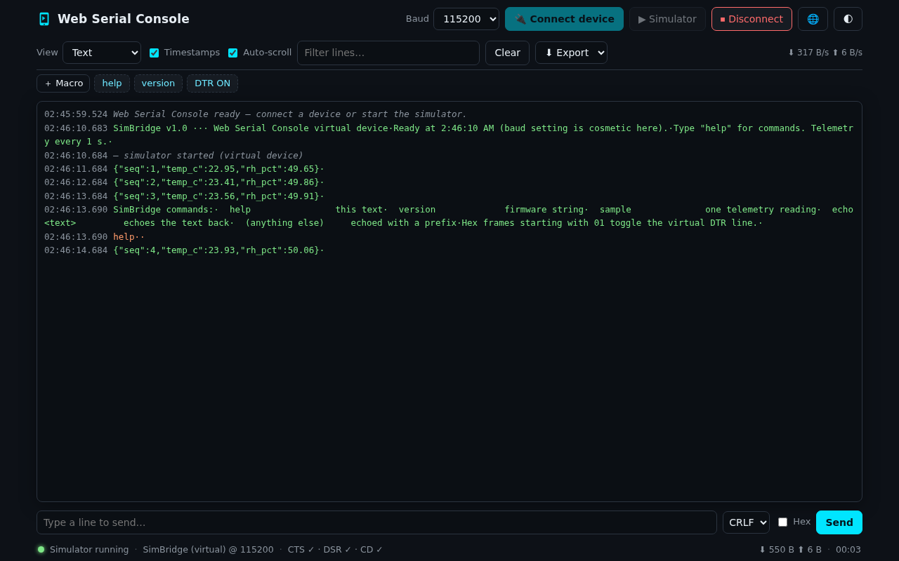
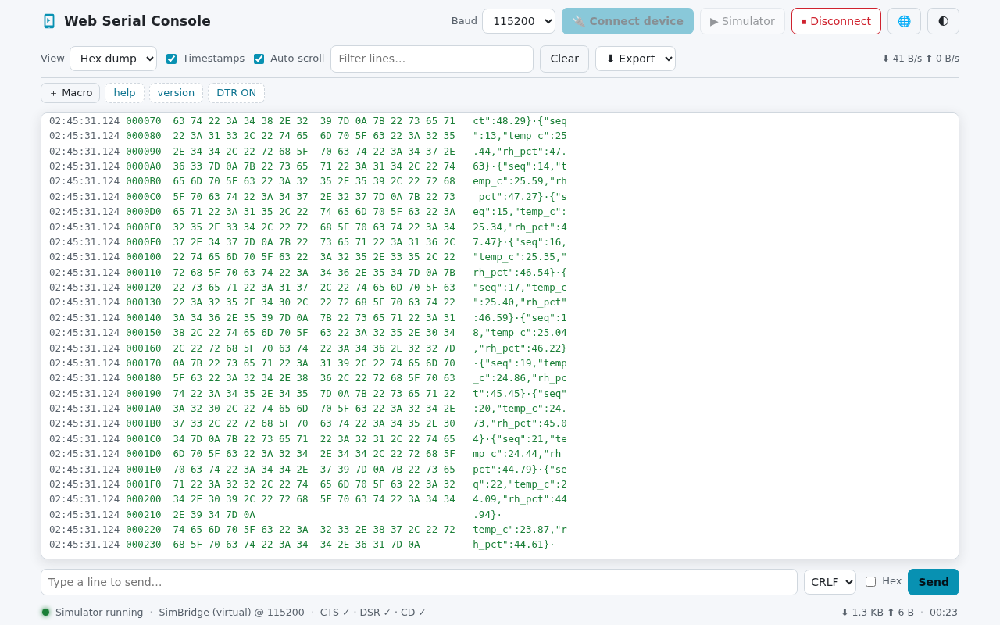
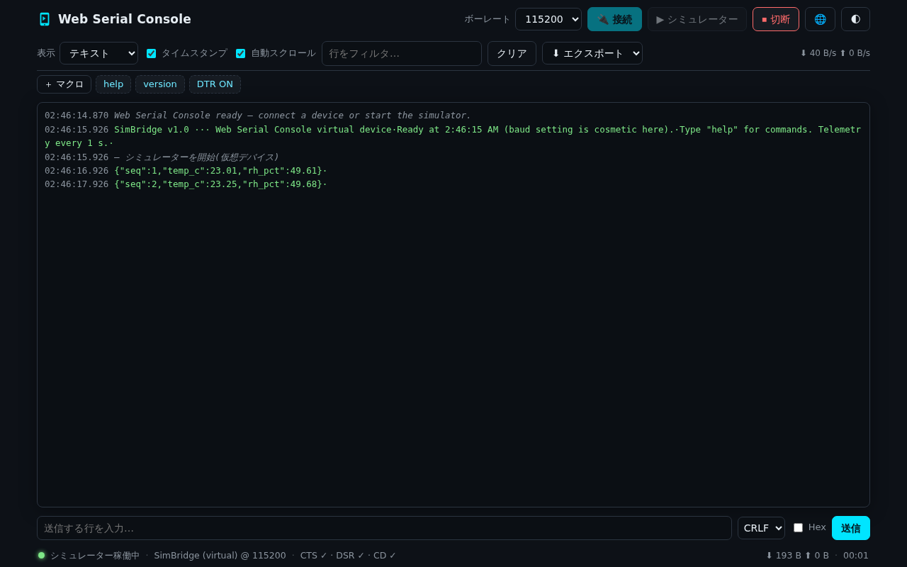

# Web Serial Console

**A serial terminal that lives in your browser.** Talk to Arduino, ESP32, USB-serial adapters and Bluetooth SPP devices with zero installs — no driver, no PuTTY, no IDE. Just Chrome and a cable.

[](https://github.com/shunichi19990314-oss/web-serial-console/actions/workflows/ci.yml)
[](LICENSE)
[](https://shunichi19990314-oss.github.io/web-serial-console/)

| Dark theme · text view | Light theme · hex dump |
| --- | --- |
|  |  |

## Why

Opening a serial monitor today still usually means installing an IDE or a desktop terminal. **Web Serial Console runs entirely in the browser**: nothing to install, nothing to configure, and nothing ever leaves your machine (the app is a static page — there is no server, no analytics, no storage beyond `localStorage` for your macros).

Typical uses:

- Quick check of an Arduino sketch on a locked-down machine or a **Chromebook**
- Debugging ESP32 / Raspberry Pi Pico boot logs without a desktop terminal
- Inspecting **Bluetooth SPP / RFCOMM** devices (paired in OS settings) — including things like earbuds exposed as serial ports
- Teaching: students open a URL, plug in a board, and see bytes immediately

## Features

- **Text & classic hex-dump views** with per-direction coloring (RX green / TX orange)
- **Timestamps, line filter, auto-scroll pause** for long sessions
- **Macros**: save named snippets (text or hex) and send them with one click
- **Send as text or hex** (`01 A7 FF`), with configurable line ending (CRLF / LF / CR / none)
- **Log export**: `.txt`, `.csv` (Excel-friendly), or `.json` with full fidelity
- **Control lines**: DTR/RTS setting, CTS/DSR/CD indicator, baud rates 1200–921600
- **One-click reconnect** to previously granted ports
- **Built-in simulator** (SimBridge virtual device) — try everything without hardware
- **English / 日本語 UI**, dark / light theme, fully responsive
- Tiny bundle: vanilla TypeScript, **no framework, no CSS library, no web fonts** (7 KB gzip JS)

## Browser support

Real devices need the **Web Serial API**:

| Browser | Status |
| --- | --- |
| Chrome / Edge 117+ (desktop) | ✅ |
| Chrome 138+ (Android) | ✅ |
| Safari / Firefox / iOS | ❌ no Web Serial (simulator still works) |

The page must be served over **HTTPS** (or `localhost`) — both the hosted demo and local dev server qualify.

## Try it

- **Hosted demo:** https://shunichi19990314-oss.github.io/web-serial-console/
- **Local:** `npm install && npm run dev` → http://localhost:5173 (localhost is a secure context, so real devices work from dev)

No hardware handy? Press **▶ Simulator**. The virtual device answers `help`, `version`, `sample`, echoes anything you type, and streams fake telemetry once a second — enough to exercise the hex view, filter, macros and export.

### Quick Arduino test

```cpp
void setup() { Serial.begin(115200); }
void loop()  { Serial.println(millis() / 1000); delay(1000); }
```

1. Plug in the board, select baud **115200**, press **Connect device** and pick the port
2. Seconds since reset start streaming — filter them, hex-dump them, or export the session

## Keyboard & interaction

- `Enter` in the input sends the line (check **Hex** to send raw bytes like `01 A7 FF`)
- Click a macro to send it; **double-click to edit** it
- The status bar shows the port, signals, byte counters, and session time

## 日本語

ブラウザだけで動くシリアルターミナルです。Arduino / ESP32 / USBシリアル / Bluetooth SPP 機器に、インストール不要でそのまま接続できます。サーバー不要の静的ページなので、入力が外部に送信されることはありません。

| 日本語UI |
| --- |
|  |

- テキスト / **Hexダンプ** 表示、タイムスタンプ、行フィルタ、自動スクロール
- **マクロ**(テキスト/Hexのスニペットをワンクリック送信)
- ログの `.txt` / `.csv` / `.json` エクスポート
- DTR/RTS 制御、CTS/DSR/CD 表示、ボーレート 1200〜921600
- **シミュレーター内蔵** — 実機がなくても全機能を試せます(`help` と入力してみてください)
- 英語 / 日本語 UI、ダーク / ライトテーマ

実機接続には Chrome/Edge 117+(デスクトップ)または Chrome 138+(Android)が必要です。Safari / Firefox ではシミュレーターのみ動作します。

## Related

Also from this account: [OpenSCQ30 Web](../openscq30-web) — control Soundcore earbuds from the browser over the same Web Serial + RFCOMM stack.

Built on the [Web Serial API](https://wicg.github.io/serial/) · Vanilla TypeScript + Vite · MIT License

⭐ If this saved you an install, a star helps others find it.
